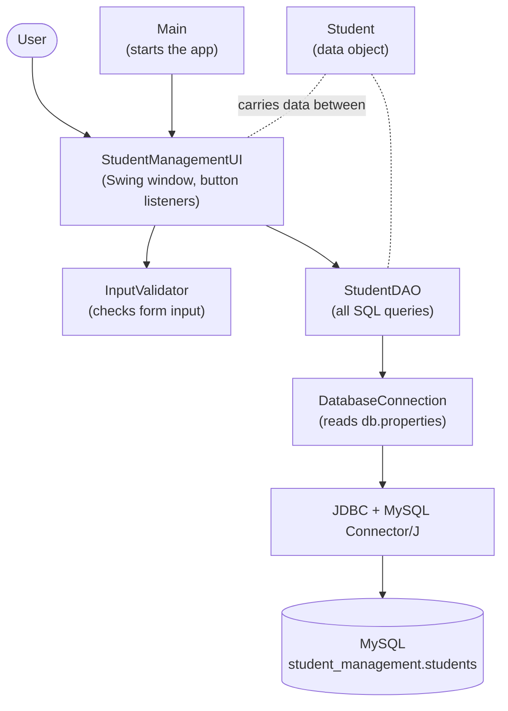
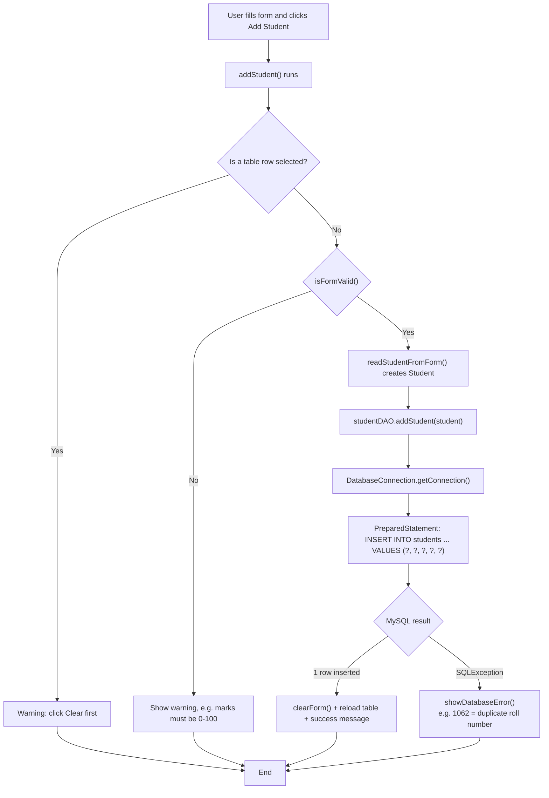
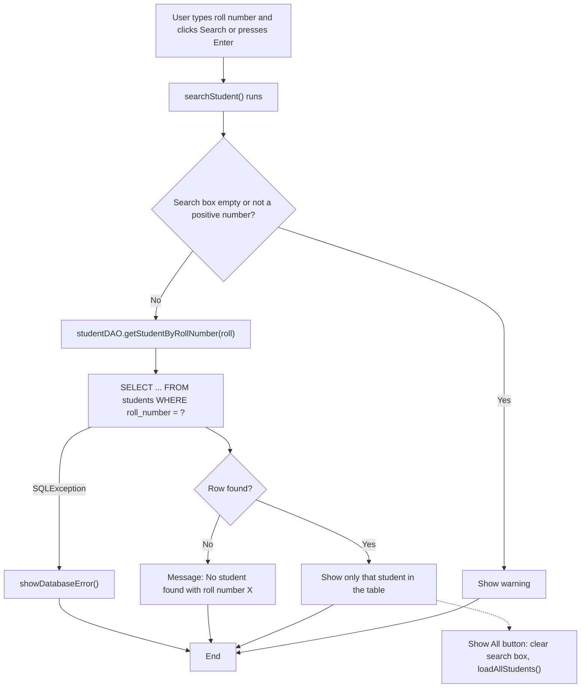
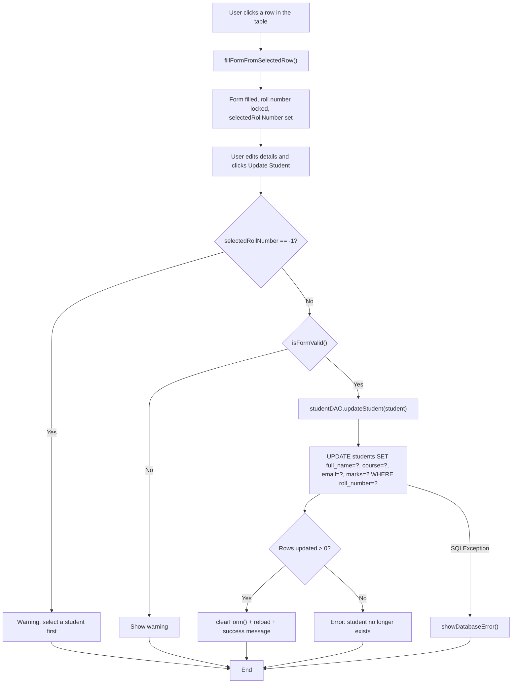
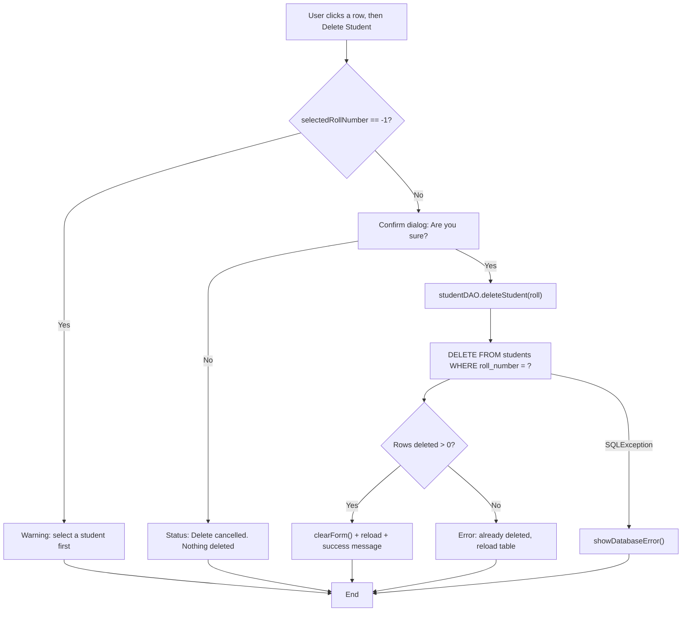

# Flow Diagrams

The diagrams use **Mermaid**. They render automatically on GitHub, and in VS Code with the *Markdown Preview Mermaid Support* extension (open the file and press `Ctrl+Shift+V`). A plain-text version follows each diagram, for printing or drawing on a board.

---

## 1. Overall Application Architecture



```
            ┌────────┐
            │  Main  │  starts the program
            └───┬────┘
                ▼
 User ──► ┌──────────────────────┐ ──► ┌────────────────┐
          │ StudentManagementUI  │     │ InputValidator │  (checks input)
          │ (window + buttons)   │     └────────────────┘
          └──────────┬───────────┘
                     ▼   Student objects travel between these layers
          ┌──────────────────────┐
          │      StudentDAO      │  (INSERT, SELECT, UPDATE, DELETE)
          └──────────┬───────────┘
                     ▼
          ┌──────────────────────┐
          │  DatabaseConnection  │  (reads db.properties)
          └──────────┬───────────┘
                     ▼
          ┌──────────────────────┐
          │ JDBC (Connector/J)   │
          └──────────┬───────────┘
                     ▼
          ┌──────────────────────┐
          │ MySQL: students table│
          └──────────────────────┘
```

---

## 2. Add Student Flow



```
Click "Add Student"
   │
   ├─ row selected? ── yes ──► "Click Clear first"            (stop)
   │
   ├─ form valid?  ─── no ───► show warning                   (stop)
   │
   ▼
Student object ──► StudentDAO.addStudent()
   ──► DatabaseConnection.getConnection()
   ──► INSERT INTO students (...) VALUES (?, ?, ?, ?, ?)
   ──► MySQL
          ├─ success ──► clear form, reload table, "Student added successfully."
          └─ error   ──► friendly message (duplicate / not running / ...)
```

---

## 3. Search Student Flow



```
Click "Search"
   ├─ invalid input ──► warning                               (stop)
   ▼
StudentDAO.getStudentByRollNumber(roll)
   ──► SELECT ... WHERE roll_number = ?
          ├─ found     ──► table shows that one student
          ├─ not found ──► "No student found with roll number X"
          └─ error     ──► friendly database message

Click "Show All" ──► clear search box ──► reload every student
```

---

## 4. Update Student Flow



```
Click a table row ──► form filled, Roll Number locked
   ▼
Edit fields ──► click "Update Student"
   ├─ nothing selected ──► warning                            (stop)
   ├─ form invalid     ──► warning                            (stop)
   ▼
StudentDAO.updateStudent(student)
   ──► UPDATE students SET ... WHERE roll_number = ?
          ├─ 1 row updated ──► clear form, reload, "Student updated successfully."
          ├─ 0 rows        ──► "No student found ... may have been deleted"
          └─ error         ──► friendly database message
```

---

## 5. Delete Student Flow



```
Select row ──► click "Delete Student"
   ├─ nothing selected ──► warning                            (stop)
   ▼
"Are you sure?"  ── No ──► "Delete cancelled." (nothing deleted)
   │ Yes
   ▼
StudentDAO.deleteStudent(roll)
   ──► DELETE FROM students WHERE roll_number = ?
          ├─ deleted ──► clear form, reload, "Student deleted successfully."
          └─ error   ──► friendly database message
```
